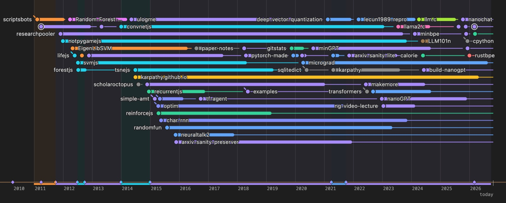
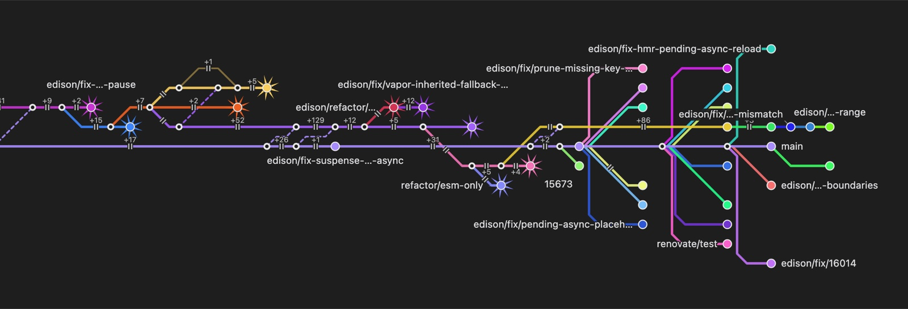
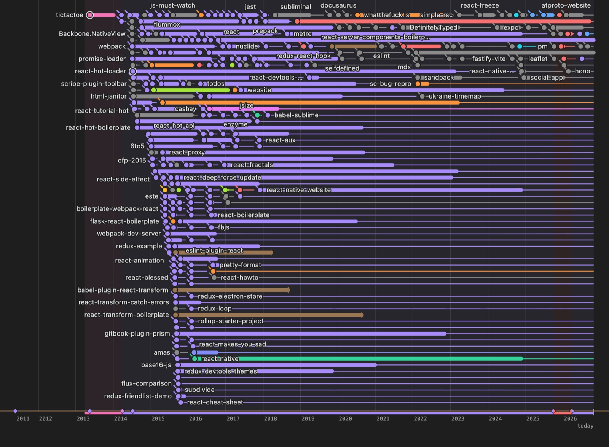
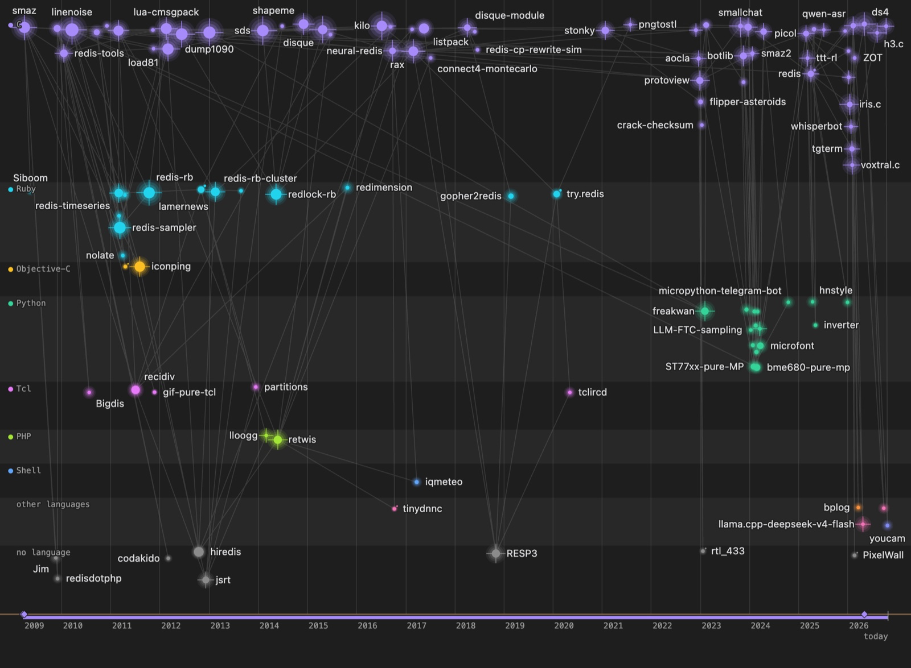
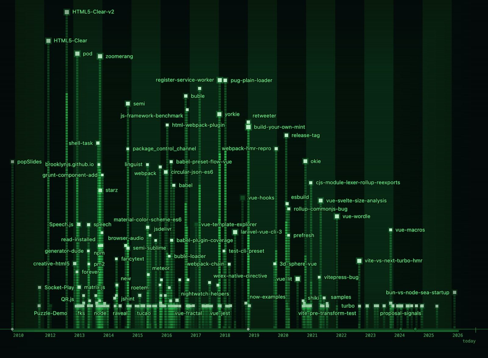
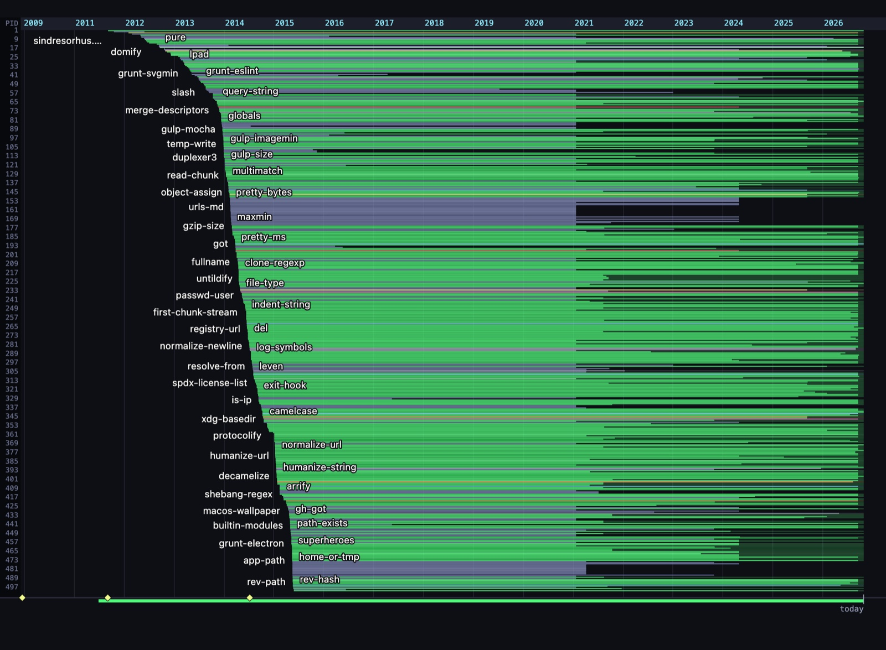
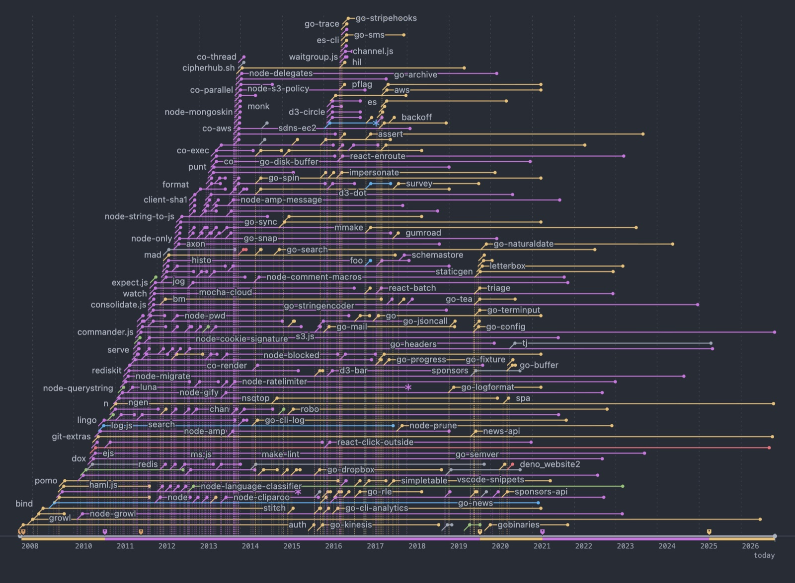
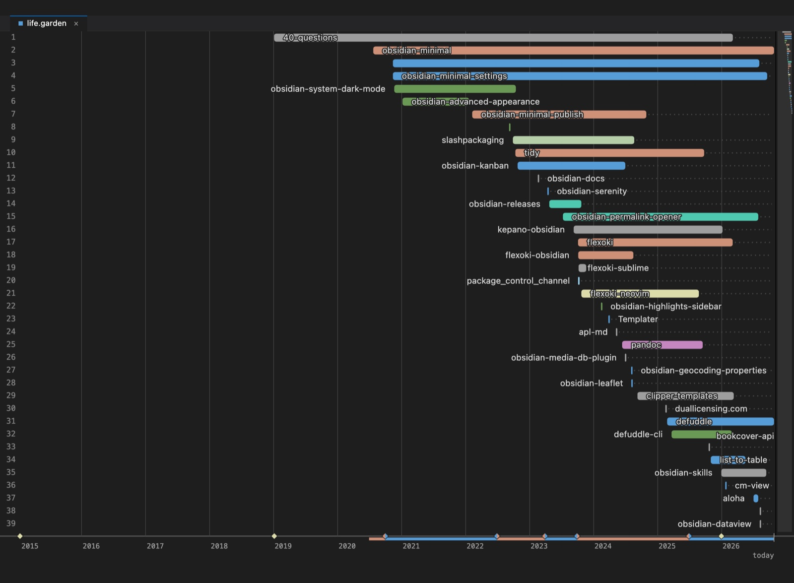
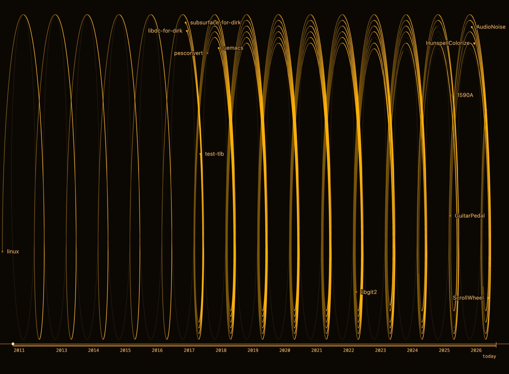

# gitube

**A tube map of any GitHub repo, and of anyone's life on GitHub.**

Paste `owner/repo` and every branch gets its own line, forking off and merging
back like a metro map. Paste a login instead and their repos become lines
through the years, from the first commit to today. It all runs in your
browser against the GitHub API: no clone, no server, no sign-up.

**Live:** https://repogarden.latesailor.dev

[](https://repogarden.latesailor.dev/?user=karpathy&view=lines)

<sub>Andrej Karpathy's fifteen years on GitHub as [life lines](https://repogarden.latesailor.dev/?user=karpathy&view=lines): each line a repo, from where it began, thick while active and thin while dormant.</sub>

## Contents

- [Gallery](#gallery)
- [Repo mode](#repo-mode)
- [Person mode](#person-mode)
- [Run it](#run-it)
- [How the data is fetched](#how-the-data-is-fetched)
- [Privacy and analytics](#privacy-and-analytics)
- [Stack](#stack)

## Gallery

A well-known repo in repo mode, then well-known developers' public profiles in
each of person mode's views. Click a picture to open it live. The profiles were
captured without a token, so a repo's size is how long it was active rather
than its commit count.

<table>
  <tr>
    <td colspan="2">
      <a href="https://repogarden.latesailor.dev/?repo=vuejs/core"></a>
      <br><b>repo mode</b> · <code>vuejs/core</code> as a metro map, the default layout: the newest end of 83 branches, each on its own lane off <code>main</code>, with the fix branches fanning out near the tip and spikes on the ones far apart from it. Opening it live takes about 85 requests, more than GitHub allows in an hour without a token.
    </td>
  </tr>
  <tr>
    <td width="50%">
      <a href="https://repogarden.latesailor.dev/?user=gaearon&view=lines"></a>
      <br><b>lines</b> · Dan Abramov (<code>gaearon</code>): 300 repos as tube-map lines, thick while active. The 2015 burst of React tooling fans out at the left.
    </td>
    <td width="50%">
      <a href="https://repogarden.latesailor.dev/?user=antirez&view=constellation"></a>
      <br><b>constellation</b> · Salvatore Sanfilippo (<code>antirez</code>): a row per language, C on top from linenoise and sds to kilo and redis, Ruby and Tcl below.
    </td>
  </tr>
  <tr>
    <td>
      <a href="https://repogarden.latesailor.dev/?user=yyx990803&view=phosphor"></a>
      <br><b>phosphor</b> · Evan You (<code>yyx990803</code>): a green CRT, each repo a stack of blocks rising where it began, from HTML5 experiments to the Vue and Vite years.
    </td>
    <td>
      <a href="https://repogarden.latesailor.dev/?user=sindresorhus&view=htop"></a>
      <br><b>htop</b> · Sindre Sorhus (<code>sindresorhus</code>): one meter per repo, lit where it was active; the oldest 500 of his small modules, row after row from 2011 on.
    </td>
  </tr>
  <tr>
    <td>
      <a href="https://repogarden.latesailor.dev/?user=tj&view=gitlog"></a>
      <br><b>git log</b> · TJ Holowaychuk (<code>tj</code>): every repo a branch off the trunk; commander.js, n and the co family through 2014, then the go-* years.
    </td>
    <td>
      <a href="https://repogarden.latesailor.dev/?user=kepano&view=minimap"></a>
      <br><b>minimap</b> · Steph Ango (<code>kepano</code>): a code editor, one numbered line per repo, from the Minimal theme to Obsidian plugins and Defuddle.
    </td>
  </tr>
  <tr>
    <td colspan="2">
      <a href="https://repogarden.latesailor.dev/?user=torvalds&view=helix"></a>
      <br><b>helix</b> · Linus Torvalds (<code>torvalds</code>): the life wound into a coil, one turn per year with January at the top, so seasons line up across turns. linux runs the whole length; subsurface, libgit2 and the 2025 guitar pedals join along the way.
    </td>
  </tr>
</table>

## Repo mode

Type `owner/repo` (or paste a GitHub URL) and press **Go**.

**Layouts.** **Metro**, the default, lays every branch on its own straight
lane, oldest commits on the left. Forks and merges are interchanges, a branch
cut off from its history starts with a dashed lead-in, and a merged branch
that was since deleted runs on as a faint line. **Organic** lets the same
graph settle under free force physics instead, which can read better for a
tangled merge history.

**Views.** **Skeleton** keeps branch tips, fork points, merges and roots, and
folds straight runs of commits into one stretch with a `+N` count. **Full**
shows every fetched commit.

**Finding your way.**

- Hover a commit to light up its neighbours.
- Pick a branch in the side panel to isolate its line, hide branches with the
  eye toggle, and filter out ones that have gone quiet (30 days, 90 days, a year).
- The **people** tab ranks contributors by commits; pick one to light up their work.
- The **cleanup** tab lists merged branches nobody deleted, with the `git push`
  command to remove the ones you tick. It also lists **diverged** branches:
  far from the default branch on both sides, so a merge will likely hurt. The
  map marks them with spikes.

**Pull requests.** Open pull requests show on the tips they come from. The
tip's ring splits into review (left) and checks (right): green, amber (half
lit while running) or red (broken), dotted for a draft. Until a pull request is
looked up, both halves keep the tip's own colour. Click a tip for the details,
and filter the branch list with `is:pr`, `checks:failing`, `review:approved`
and the like.

**More.**

- **Replay** in the status strip rebuilds the map from its first loaded commit,
  and **rec** saves that as a silent video.
- **vs** (the swords in the side panel) opens a second repo beside this one and
  scores the two, measure by measure.
- Save the picture as a PNG, or the data as a `.json` file. Drop a saved file
  on the page to open it again with no API requests. Files saved by
  repo-garden, gitube's old name, still open.
- The address bar is a share link: it names the repo, the selected branch or
  person, and the other side of a vs.

## Person mode

Type a GitHub login where a repo goes (`octocat`, `@octocat` or a
`github.com/octocat` link), or open `?user=octocat`. It shows one user's
coding life: when each repo was born, when it was busy, when it went quiet,
which languages led when, and their milestones. Milestones are joining
GitHub, the first repo, the most starred one and language switches, plus with
a token the first pull request, the first issue and the longest streak.

An organization is not a user: its login says "that's an organization" (a
bot's, "that's a bot"), and its repos still open as `owner/repo`.

**Seven views** paint the same life on one canvas. Pick one in the side panel,
or with `&view=` in the link. They all share the panel, the inspector (hover a
repo or a day), the theme, the replay and the poster.

| View | What it draws |
|---|---|
| `lines` (default) | Each repo is a line from where the person's part in it starts, thick while active and thin while dormant, thicker for more commits with a token. Milestones are stations, archived repos end at a terminus, forks branch in, and repos they only contributed to start hollow. |
| `constellation` | Each repo is a star, placed by when it starts (across) and its language (down), sized by activity, glowing by stars, with faint links between repos active in the same months. |
| `phosphor` | A green CRT: each repo a stack of blocks rising where it starts, taller the busier it was. |
| `htop` | A system monitor: each repo a numbered row whose meter is lit where it was active. |
| `gitlog` | Like `git log --graph`: each repo a branch off the trunk, with commit dots and a short hash made from its dates, never its name. |
| `minimap` | A code editor: each repo a numbered line whose syntax-coloured tokens are its active spans, with a minimap strip at the right. |
| `helix` | An amber vector display: the life wound into a coil, one turn per calendar year with January at the top, each repo a thread on its own ring. |

The last five keep their own terminal colours whatever the theme. A link with
`&view=garden`, from before that view was retired, opens `lines`.

**Around the canvas.**

- The side panel holds the repo list (search, hide, pick one to spotlight it),
  the milestones, and the legend, which ends with what GitHub's data leaves out.
- **Replay** plays the life from its first day to today. Months with activity
  get equal time and quiet ones a tenth of it, so empty years go by quickly.
  Pick a length from 10 to 60 seconds, and **rec** saves a silent video
  (`<login>-life-timelapse-<day>`, WebM or mp4 in Safari).
- **Poster** saves a PNG of the view on show, fully drawn, with the avatar,
  the login, the years and the top three milestones (`<login>-life-poster-<day>.png`).
- **Share link**: the address bar names the user and the view, and nothing else.

**Private repos.** With a token, a profile can include private repos: your
own, or ones the person contributed to that your token can see. Their names
are hidden everywhere by default, shown as "private repo" with a lock. The
panel's search matches only what is shown, so a name can't be found by
guessing it. The panel's toggle reveals them on this screen, for this login
only, until a reload, a new search or leaving person mode. Posters and
recordings show names exactly as the screen does. Their file names carry only
the login. No link, address bar or analytics event ever carries a repo name.

**Cache.** A profile fetched in this browser within a day opens again for free
(IndexedDB, six profiles at most). Refresh in the status strip fetches it
again. Copies fetched with and without a token are kept apart.

## Run it

```bash
npm install
npm run dev
```

Then open http://localhost:5173.

| Command | What it does |
|---|---|
| `npm run dev` | Vite dev server |
| `npm run build` | typecheck and production build to `dist/` |
| `npm test` | Vitest: graph engine, API clients, stores, UI, person mode |
| `npx tsx scripts/smoke.ts owner/repo [maxBranches]` | live fetch plus graph checks against the real API |
| `npx tsx scripts/smoke-profile.ts <login> [--token-env NAME]` | live person-mode fetch plus sanity checks. With `--token-env` it reads a token from that environment variable (never printed) and runs the GraphQL tier. Exits 3 on a core rate limit without retrying |

**Deploy.** Pushes to `master` deploy to https://repogarden.latesailor.dev on
the Oracle VPS through GitHub Actions. One-time setup (DNS, nginx, the deploy
key) is in [DEPLOY.md](DEPLOY.md).

**Token.** Add a GitHub personal access token with the key icon for private
repos, a much higher rate limit and, in person mode, the commits GitHub
counted. It stays in this browser's storage and is only ever sent to GitHub.

## How the data is fetched

GitHub allows 60 requests an hour without a token, and 5,000 with one.

### A repo

1. `GET /repos/{o}/{r}` for the default branch.
2. `GET /repos/{o}/{r}/branches`, paginated, capped at 200 branches.
3. One `compare/{default}...{branch}` call per branch, for its merge base and
   its own commits.
4. A walk of the default branch's history, stopping once every fork point is
   connected.
5. `src/graph` turns the commits into nodes and child-to-parent links, colours
   each commit by the first branch that reaches it, and folds straight runs in
   skeleton view.

That is roughly one request per branch.

Open pull requests come after the map (`src/api/pulls.ts`):

- **Without a token:** `GET /repos/{o}/{r}/pulls` costs 1 request per 100 open
  pull requests, at most 3, and is skipped below 5 requests left. A pull
  request's review and checks cost 3 more, read when its tip is opened, while
  at least 15 are left.
- **With a token:** one GraphQL query per 40 branches, review and checks
  included, and no REST requests.

Pull requests from forks have no branch here and are not drawn. Pull requests
are never cached or saved.

### A person

Both tiers start with `GET /users/{login}` (1 request), which settles a login
that doesn't exist, or is an organization or a bot.

**Without a token: REST, 3 to 9 requests.**

1. `GET /users/{login}/repos?type=owner&sort=created&direction=asc`, at most 5
   pages: the user's own public repos, the oldest 500.
2. `GET /users/{login}/events/public`, at most 3 pages, for the days they
   pushed. If these fail, the profile stands without them.

Each repo is one span from its creation to its last push, and the last 30 or
so days add pushes per repo per day.

**With a token: GraphQL, about one query per year of account age.** One query
lists the years they contributed in and their own repos, private ones too when
the login is yours. Then contributions are read in calendar quarters, four to
a query. A query GitHub is too slow for is split in halves, down to one
quarter. A quarter that still fails is cut short, and the legend names it.
This tier adds the day-by-day calendar, commits per repo per day, the repos
they only contributed to (up to 100 a quarter), and the first pull request
and issue. It spends the token's GraphQL points, not the core budget the
requests-left counter shows.

**The fallback.** When GraphQL refuses the token, hits a rate limit, still
times out or answers with anything unexpected, the profile is read the REST
way instead, and the status strip says why. A profile filled this way isn't
cached, so the next search tries GraphQL again. There is no fallback when
the identity call itself fails; those show their error card.

### What GitHub's data leaves out

Each view's legend lists these:

- Without a token there are no commit counts. Recent activity is pushes per
  repo per day, and GitHub keeps only about 30 days of events, so earlier days
  are unknown rather than quiet. Only the user's own public repos show.
- With a token, GitHub counts a commit only on a repo's default branch (or
  `gh-pages`), made with an email linked to the account, and not in a fork.
- Contributions to private repos count only with a token that has `read:user`
  and can see the repo. Otherwise GitHub gives only their number, if the user
  shares it.
- Days are GitHub's, in US Pacific time.
- GitHub's GraphQL calendar can differ from the github.com profile by a few
  contributions a year.
- Caps: 500 own repos in either tier, and with a token 100 repos a quarter. A
  profile cut short says so.

## Privacy and analytics

The live site counts visits with Umami, self-hosted at `stats.latesailor.dev`.
The tracker sets no cookies and writes nothing to the browser's storage.

**What reaches Umami.** Each pageview and event is one request carrying:

- The page as its origin only (`https://repogarden.latesailor.dev/`), never the
  path, query string or fragment. Share links keep their repo or user in the
  query string, so a pageview says someone opened gitube, not what they
  looked at.
- The referrer, cut down to `/` within the site or the other site's origin.
- The screen size, the browser's language, the page title (always `gitube`),
  the hostname and the website ID.
- For an event, its name and the data in the tables below, and nothing else.

Repo mode sends these:

| Event | Data | Sent when |
|---|---|---|
| `grow` | `mode: 'repo'`, `branches` (a bucket: `1`, `2-5`, `6-20`, `21-50`, `51-100`, `101+`), `cached`, `token`; `repo` only for a live fetch without a token | a repo's data arrived after Go, an example chip, a share link or a refresh: once per request. Not for a vs challenger, a token change, a background refetch or an opened file |
| `layout-switch` | `layout`: `metro` or `organic` | another layout is picked |
| `theme-switch` | `theme`: the theme's id | the theme picker closes on a different theme than it opened with |
| `view-mode` | `view`: `skeleton` or `full` | another view is picked |
| `timelapse-play` | none | the replay is opened |
| `export` | `format`: `png`, `webm` (also when Safari records mp4), `json` or `garden-file` | a file is saved, or a saved file is opened (`garden-file`) |
| `battle-start` | none | a vs is started from the side panel (not from a share link) |
| `pr-overlay` | `state`: `on` or `off` | once per answer from GitHub about the repo's open pull requests |
| `share-copy` | none | the share link is copied |
| `token-added` | none | a new token is saved |
| `fetch-error` | `code`: the error code (`not_found`, `rate_limited`, ...) | the repo fails to load: the code only |

Person mode sends these (`src/profile/analytics.ts` has the rules):

| Event | Data | Sent when |
|---|---|---|
| `grow` | `mode: 'person'`, `source` (`rest` or `graphql`), `cached`, `token`; `login` only for a live fetch without a token | the profile arrived after a search, a `?user=` link or a refresh: once per request |
| `view-switch` | `view`: one of the seven view ids | another view is picked |
| `timelapse-play` | none | the replay is opened |
| `export` | `format: 'webm'` | a replay recording is saved |
| `poster-export` | none | a poster is saved |
| `share-copy`, `theme-switch`, `token-added` | as in repo mode | as in repo mode |

The event names and values predate the rename (`grow`, `battle-start`,
`garden-file`) and stay as they are, so the stats keep one history.

Umami also gets what any server gets: the IP address and the User-Agent, from
which it works out the location, browser, OS and device type.

**The rules.**

- Umami never gets the GitHub token, the query string or the URL path. The
  tracker drops the query string and fragment (`data-exclude-search`,
  `data-exclude-hash`), and `beforeSend` in `src/analytics/umami.ts` cuts the
  URL to its origin again before every send.
- An event names a repo or a login only when it was fetched without a token,
  which proves it public. With a token set, `track()` drops `repo` and `login`.
  A cached copy is never named. No event names a private repo.
- Every value is checked on the way out: anything that looks like a token or
  a query string is dropped, and strings are cut to 50 characters.
- Do Not Track is honoured, and only `repogarden.latesailor.dev` is counted.
  To stop counting your own visits, run
  `localStorage.setItem('umami.disabled', '1')` in the console on the live site.

**Setup.**

- The website ID is `VITE_UMAMI_WEBSITE_ID` in `.env.production`. It isn't a
  secret. Empty turns analytics off, and `npm run dev` never loads the tracker.
- The tracker isn't bundled: `initAnalytics()` adds
  `https://stats.latesailor.dev/script.js` after the page loads. Up to 20 early
  events wait for it and are checked again before they go.
- `VITE_UMAMI_DOMAINS` (comma-separated hostnames) replaces the counted host,
  only for checking a local production build:
  `VITE_UMAMI_DOMAINS=localhost npm run build && npm run preview`. Never set
  it for the deployed build, or the live site counts nothing.
- The site's Content-Security-Policy must allow `stats.latesailor.dev`
  (`script-src` and `connect-src`); see
  [DEPLOY.md, step 6](DEPLOY.md#6-analytics-umami-update-the-headers-snippet-before-merging).
  The deploy's smoke test fails if the live policy doesn't list it.

## Stack

Vite 8, React 19, TypeScript 7, Tailwind v4, react-force-graph-2d (d3-force on
canvas), @octokit/rest, TanStack Query, Zustand, Vitest.
[PLAN.md](PLAN.md) has the original design notes and
[PROFILE_SPEC.md](PROFILE_SPEC.md) person mode's.
